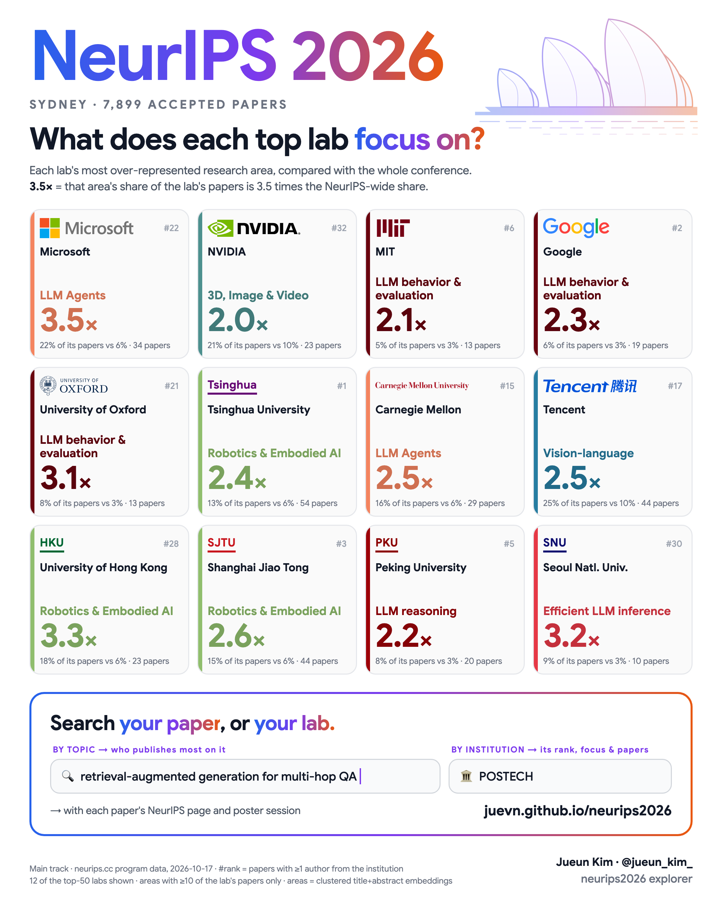

# NeurIPS 2026 Explorer

Two searches over the 5,629 accepted NeurIPS 2026 main-track papers:

- **Find your institution.** Rank, paper count and research-area mix for every university, lab and company.
- **Search by topic or paper.** Type a topic or paste an abstract. The page finds the closest papers by meaning and shows which universities and companies wrote the most of them.

**Live page:** {{SITE_URL}}

## What's here

- `index.html`: the whole site (home, institution search, topic search). Static, no build step, works on GitHub Pages.
- `data.js`: institution-level totals.
- `papers.js` + `papers.bin`: the topic-search index. Paper titles, the institutions on each paper and the research area, plus one 384-dimensional embedding per paper (int8, about 2 MB). No author names.
- `neurips2026_institutions.csv`: the same table as a CSV.
- `assets/poster.png`: the summary poster.

## Data

| Column | Meaning |
|---|---|
| `rank` | Rank by paper count. Institutions with the same count share a rank. |
| `institution` | Normalized institution name. |
| `papers` | Accepted main-track papers with at least one author from this institution. |
| `pct_of_papers` | `papers` as a share of all 5,629 main-track papers. Shares add up to more than 100%. |
| `fractional_papers` | Each paper split equally across its authors, then across each author's institutions. Adds up to 5,629. |
| `country` | Country code, for institutions in the hand-checked table. Blank otherwise. |
| `sector` | `academia` or `industry`. |
| Area columns | Papers per research area. Each paper is in exactly one area. |

## How it was made

- **Source.** The official neurips.cc program data for NeurIPS 2026, which lists each author's institution as written on their OpenReview profile. Snapshot taken 2026-10-17. Main track only.
- **Names.** Institution strings are normalized with a hand-checked table of about 380 institutions plus rules for sub-units ("School of CS, X University" counts as X University). Google includes DeepMind. Meta includes FAIR. All Chinese Academy of Sciences institutes are merged. HKUST and HKUST (Guangzhou) are separate. Less common names are grouped by exact spelling, so a small institution can appear under more than one name.
- **Research areas.** Not official tags. Titles and abstracts were embedded with `BAAI/bge-small-en-v1.5`, clustered with k-means (k=14), and the clusters were merged and named into 12 areas from their top terms. Borders between neighbouring areas such as LLMs, LLM agents and multimodal are fuzzy. With only a few papers, an institution's mix is noisy.
- **Sector.** Companies and corporate labs are industry. Universities and public or non-profit institutes such as CAS, Max Planck, RIKEN, Shanghai AI Lab and Mila are academia.
- **Topic search.** Runs entirely in the browser. The query is embedded with the same model used for the papers (`Xenova/bge-small-en-v1.5` via transformers.js, about 33 MB, downloaded once), compared with every paper, and the closest 50/100/200 papers are counted by institution. Nothing typed is sent to a server. If the model cannot load, the page falls back to keyword matching on titles.
- **Privacy.** No author names are published. The topic index contains paper titles and the institutions on each paper, which are public in the NeurIPS program.

## Corrections

Found a wrong or split institution? Please [open an issue]({{REPO_URL}}/issues/new) with the institution name and what it should be.

## Credit

Made by Jueun Kim (POSTECH) · [@jueun_kim_](https://x.com/jueun_kim_), author of [Hi-Q](https://neurips.cc/virtual/2026/poster/155067) (NeurIPS 2026, Sydney Poster Session 6). Format inspired by Pierre-Alexandre Balland's NeurIPS 2025 institution treemap.
